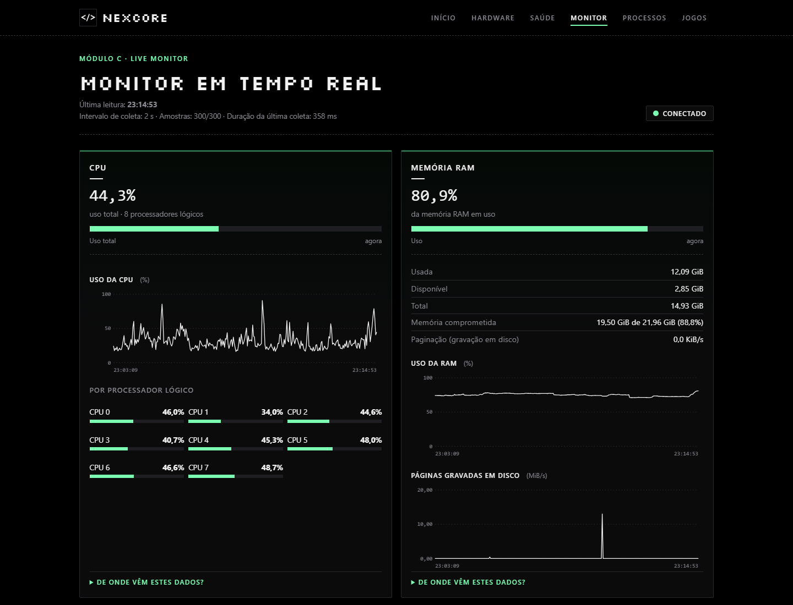

<p align="center">
  
</p>

<h1 align="center">NEXCORE</h1>

<p align="center">
  <strong>Conheça o seu hardware.</strong><br>
  Identificação de componentes, saúde do computador, monitoramento em tempo real, processos e compatibilidade com
  jogos, tudo lido do próprio sistema, sem valores simulados.
</p>

<p align="center">
  <a href="https://github.com/not-toledo/Projeto-Integrador-SO/releases/latest"></a>
  <a href="LICENSE"></a>
  
  
  
</p>

<p align="center">
  <a href="https://github.com/not-toledo/Projeto-Integrador-SO/releases/latest"><strong>⬇ Baixar o instalador</strong></a>
  ·
  <a href="#funcionalidades">Funcionalidades</a>
  ·
  <a href="#desenvolvimento">Desenvolvimento</a>
  ·
  <a href="docs/CHANGELOG.md">Novidades</a>
</p>

<p align="center">
  
</p>

> Projeto Integrador da disciplina de **Sistemas Operacionais**. Até a versão 3.2 o projeto se chamava **PCCheck**.

## Instalar no Windows

1. Baixe **`NEXCORE-Setup-<versão>.exe`** na [página de releases](https://github.com/not-toledo/Projeto-Integrador-SO/releases/latest).
2. Execute. Como o instalador não tem certificado de assinatura de código, o Windows pode mostrar
   *"O Windows protegeu o computador"*: clique em **Mais informações → Executar assim mesmo**.
3. Escolha **Instalar para todos os usuários** (pede administrador) ou **Instalar só para mim**.
4. Abra o **NEXCORE** pelo Menu Iniciar ou pela Área de Trabalho. Ele abre no navegador e fica na bandeja do Windows
   (ao lado do relógio), com **Abrir NEXCORE** e **Sair**.

Não é preciso instalar Java, Node.js nem outras ferramentas: tudo vai dentro do instalador.

| | |
|---|---|
| **Requisitos** | Windows 10 1903 ou mais novo, 64 bits, cerca de 95 MB livres |
| **Temperaturas e ventoinhas** | Marque o **driver PawnIO** na instalação (abre o instalador oficial do PawnIO) e aceite o aviso de administrador ao abrir o NEXCORE |
| **Seus dados** | Configuração, logs e histórico em `%LOCALAPPDATA%\NEXCORE`, preservados em atualizações |
| **Conferir o download** | Compare `Get-FileHash .\NEXCORE-Setup-<versão>.exe` com o `.sha256` da release |

## Funcionalidades

| Tela | O que mostra |
|---|---|
| **Início** | Resumo real do computador, leituras ao vivo e acesso a cada módulo. |
| **Hardware** | Sistema operacional, processador, memória, placas de vídeo, placa-mãe, discos e volumes, com a origem de cada dado no Windows e no Linux. |
| **Saúde** | Temperatura, espaço em disco, memória, pressão de memória e saúde SMART dos discos, com régua até o limite e alertas explicados. |
| **Monitor** | CPU (total e por processador lógico), RAM, paginação, GPU, temperaturas, ventoinhas e discos em tempo real, com gráficos. |
| **Processos** | Programas em execução com CPU, memória, threads e prioridade, agrupados por nome, com filtro e ordenação (somente leitura). |
| **Jogos** | Requisitos da Steam comparados com o seu hardware. CPU e GPU de modelos diferentes são comparadas pelo benchmark do [Blender Open Data](https://opendata.blender.org) (CC0), dizendo qual é melhor e por quanto. Também lista os jogos instalados e faz a pré-checagem antes de jogar. |

<p align="center">
  
  
</p>
<p align="center">
  
</p>

### Princípios

- **Dados reais:** nada é simulado ou estimado. O que o sistema não informa aparece como *Não disponível*; falha de
  coleta aparece como falha, e nenhum dos dois é tratado como defeito do hardware.
- **Local:** a API só aceita conexões deste computador (`127.0.0.1`). Só a pesquisa de jogos usa a internet (Steam).
- **Somente leitura:** o NEXCORE observa o sistema; não muda configurações nem encerra programas.

## Como funciona

```
Navegador (React)  ──►  API local (Spring Boot, 127.0.0.1)  ──►  Agente (Java + OSHI)  ──►  Sistema operacional
                                      │                                                       (WMI, contadores, /proc, /sys)
                                      └──►  Leitor de sensores (C# + LibreHardwareMonitorLib)  ──►  sensores e SMART
```

Na versão instalada, um único `NEXCORE.exe` (com Java 21 embutido) serve a interface e a API, inicia o leitor de
sensores e abre o navegador. Detalhes em [docs/documentacao-de-projeto.md](docs/documentacao-de-projeto.md) e
[docs/diagramas.md](docs/diagramas.md).

| Camada | Tecnologia |
|---|---|
| Interface | React 19, TypeScript, Vite, Vitest, Testing Library |
| API | Spring Boot 3.3.5 (Java 21) |
| Coleta | [OSHI](https://github.com/oshi/oshi) 6.6.5 |
| Sensores | C# (.NET Framework 4.8) e [LibreHardwareMonitorLib](https://github.com/LibreHardwareMonitor/LibreHardwareMonitor) 0.9.6 |
| Distribuição | `jpackage`/`jlink` e [Inno Setup](https://jrsoftware.org/isinfo.php) |

## Desenvolvimento

Requisitos: **JDK 21**, **Maven 3.9+**, **Node.js 22.22.2+** e **.NET SDK 8+** (só para compilar o leitor de
sensores). Funciona em Windows e Linux; o Windows é a plataforma principal.

```bash
# Terminal 1 — API em http://127.0.0.1:8080 (compila o leitor de sensores e o agente na primeira vez)
scripts\run-backend.bat          # Windows
scripts/run-backend.sh           # Linux

# Terminal 2 — interface em http://localhost:5173
cd frontend
npm install
npm run dev
```

- Ao iniciar, o Windows pede permissão de administrador para o leitor de sensores: aceite para ter temperaturas,
  ventoinhas e SMART (veja [docs/sensores.md](docs/sensores.md)).
- Se a porta 8080 já estiver em uso, o script para antes de recompilar o agente (trocar o agente com outro backend
  aberto causaria erro 500). Feche o outro backend e rode de novo.
- Teste rápido: `http://127.0.0.1:8080/api/ping` → `{"status":"UP","app":"NEXCORE","version":"4.0.0"}`.
- Cada tela tem endereço próprio (ex.: `http://localhost:5173/#/live`). O Vite encaminha `/api` para o backend; para
  outro endereço de API, defina `VITE_API_BASE`.

### Gerar o instalador

```powershell
powershell -ExecutionPolicy Bypass -File installer\build.ps1     # testes, interface, backend, NEXCORE.exe e instalador
```

Gera `build\instalador\NEXCORE-Setup-<versão>.exe` e o `.sha256`. Requer também o Inno Setup 6.7+. Detalhes em
[installer/README.md](installer/README.md).

### Testes

| O quê | Comando |
|---|---|
| Agente e backend | `mvn test` |
| Interface | `cd frontend && npm test && npm run build` |
| API (com o backend aberto) | `tests/verificar-api.sh`, `verificar-saude.sh`, `verificar-live.sh`, `verificar-jogos.sh`, `verificar-processos.sh` |
| Agente de ponta a ponta | `mvn -pl agent package` e `tests/verificar-agente.sh` |
| Documentação | `scripts/testes-documentacao.sh` |

Detalhes em [docs/processo-devops.md](docs/processo-devops.md).

### Configuração

Desenvolvimento: `backend/src/main/resources/application.properties`. Versão instalada:
`%LOCALAPPDATA%\NEXCORE\config\nexcore.properties` (criado na primeira execução e nunca sobrescrito).

| Chave | Padrão | Função |
|---|---|---|
| `server.port` | `8080` (instalado: `47820`) | Porta local da interface e da API. |
| `nexcore.health.*` | ver arquivo | Limites do Health Check (temperatura, disco, RAM, SMART). |
| `nexcore.monitor.interval-ms` | `2000` | Intervalo entre coletas do Monitor (mínimo 500). |
| `nexcore.monitor.history-size` | `300` | Amostras mantidas em memória (10 a 3600). |
| `nexcore.sensors.enabled` | `true` | Liga ou desliga o leitor de sensores. |
| `nexcore.sensors.elevate` | `true` | Pede permissão de administrador ao iniciar (temperaturas, ventoinhas, SMART). |
| `nexcore.history.data-dir` | (vazio) | Pasta do histórico; vazio usa `NEXCORE_DATA_DIR` ou o padrão do SO. |

### Coleta agendada (opcional)

Registra uma coleta a cada N minutos no agendador do sistema, mesmo com o NEXCORE fechado (página `#/history`):
`scripts\agendar-coleta.bat instalar 15` (Windows) ou `scripts/agendar-coleta.sh instalar 15` (Linux). Também:
`status`, `agora` e `remover`. Detalhes em [docs/api/api-historico.md](docs/api/api-historico.md).

## Estrutura do repositório

```
├── agent/        Agente de coleta (Java 21 + OSHI)
├── backend/      API Spring Boot e NexcoreLauncher (versão instalada)
├── sensor-host/  Leitor de sensores (C# + LibreHardwareMonitorLib)
├── frontend/     Interface (React + TypeScript + Vite)
├── installer/    Build da versão instalável e instalador (Inno Setup)
├── branding/     Logotipo oficial e recursos gerados (ícone, PNGs, imagens do instalador)
├── docs/         Documentação de projeto, APIs, processo, diagramas e histórico de versões
├── scripts/      Execução, coleta agendada, benchmarks e testes de documentação
└── tests/        Verificações ponta a ponta (agente e API)
```

## Documentação

- [Documentação de projeto](docs/documentacao-de-projeto.md): objetivo, escopo, requisitos, arquitetura e [limitações conhecidas](docs/documentacao-de-projeto.md#limitações-conhecidas).
- [APIs](docs/documentacao-api.md): endpoints e convenções de resposta.
- [Processo de desenvolvimento](docs/processo-devops.md): ambiente, versionamento, testes e [solução de problemas](docs/processo-devops.md#solução-de-problemas).
- [Sensores](docs/sensores.md), [diagramas](docs/diagramas.md) e [histórico de versões](docs/CHANGELOG.md).

## Contribuindo

Contribuições são bem-vindas. Leia o [guia de contribuição](CONTRIBUTING.md) e o [código de conduta](CODE_OF_CONDUCT.md).
Para relatar uma vulnerabilidade, siga a [política de segurança](SECURITY.md) (relato privado, não em Issues públicas).

## Integrantes

- Gabriel — *pendente: sobrenome, RA e demais integrantes do grupo.*

## Licença

Distribuído sob a [licença MIT](LICENSE). Componentes de terceiros incluídos na versão instalada e suas licenças:
[installer/TERCEIROS.txt](installer/TERCEIROS.txt).
