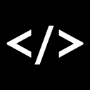

<p align="center"></p>

# NEXCORE

Aplicação local de identificação, diagnóstico básico e monitoramento de hardware.
Projeto Integrador de Sistemas Operacionais.

**Versão 4.0.0.** Até a V3.2 o projeto se chamava **PCCheck**; a partir da 4.0.0 o produto passou a se chamar NEXCORE
(as variáveis de ambiente `PCCHECK_*` continuam aceitas e as coletas da pasta antiga são copiadas para a nova).
Histórico de mudanças em [docs/CHANGELOG.md](docs/CHANGELOG.md).

O NEXCORE coleta dados **reais** do próprio computador. Dados indisponíveis aparecem como "Não disponível" ou
"Sem leitura": o sistema nunca simula nem estima valores.

## Módulos

A tela **Início** apresenta o NEXCORE com um resumo real do computador e leituras ao vivo, e leva a cada módulo:

| Módulo | Nome | O que faz |
|---|---|---|
| A | Hardware Overview | Identifica sistema operacional, CPU, memória, GPU, placa-mãe e armazenamento. |
| B | Health Check | Avalia temperatura, espaço em disco e uso de RAM, com alertas explicáveis. |
| C | Live Monitor | Mostra CPU, RAM, GPU, sensores e discos em tempo real, com gráficos. |
| — | Processos | Lista os programas em execução com CPU, memória, threads e prioridade, como o sistema operacional informa (somente leitura). Ver [API](docs/api/api-processos.md). |
| D | Game Compatibility | Pesquisa jogos na Steam e compara requisitos publicados com o hardware local (CPU/GPU de modelos diferentes pelo benchmark do [Blender Open Data](https://opendata.blender.org), CC0), lista os jogos instalados e faz a pré-checagem antes de jogar. Ver [plano](docs/plano-modulo-d.md) e [API](docs/api/api-games.md). |

## Documentação

- [Documentação de projeto](docs/documentacao-de-projeto.md): objetivo, escopo, requisitos, arquitetura e limitações.
- [Documentação de APIs](docs/documentacao-api.md): endpoints e convenções de resposta.
- [API de compatibilidade](docs/api/api-games.md): pesquisa Steam, requisitos e comparação.
- [Relatório da implementação do Módulo D](docs/RELATORIO_IMPLEMENTACAO_MODULO_D.md): revisão, entregas e validações pendentes.
- [Processo de desenvolvimento](docs/processo-devops.md): ambiente, versionamento, testes e solução de problemas.
- [Diagramas](docs/diagramas.md): arquitetura, fluxo do Live Monitor e estados das métricas.
- [GPU e sensores](docs/sensores.md): leitor de sensores interno (temperatura da CPU, ventoinhas e GPU).
- [Checklist de revisão](docs/checklist-documentacao.md).
- [Como contribuir](CONTRIBUTING.md) e [Política de segurança](SECURITY.md).

## Tecnologias

- Java 21 e [OSHI](https://github.com/oshi/oshi) 6.6.5 (agente de coleta)
- C# (.NET Framework 4.8) e [LibreHardwareMonitorLib](https://github.com/LibreHardwareMonitor/LibreHardwareMonitor) 0.9.6 (leitor de sensores interno)
- Spring Boot 3.3.5 (API local)
- React 19 com TypeScript, Vite, Vitest e Testing Library (interface)
- Maven, JUnit 5, Shell Script
- Fonte [Silkscreen](https://github.com/googlefonts/silkscreen) (OFL) nos títulos da interface

## Requisitos

- **JDK 21**
- **Maven 3.9+**
- **.NET SDK 8+** (somente para compilar o leitor de sensores; para executar basta o .NET Framework 4.8 do Windows)
- **Node.js 22.22.2 ou superior** (o `npm run dev` aceita 20.19+, mas as dependências de teste atuais exigem 22.22.2+)

Funciona em Windows e Linux; a primeira versão prioriza o Windows.

## Instalar no Windows (usuário final)

1. Baixe `NEXCORE-Setup-<versão>.exe` (e, se quiser conferir, o `.sha256` do mesmo release).
2. Execute e escolha **Instalar para todos os usuários** (pede administrador) ou **Instalar só para mim**.
3. Abra o **NEXCORE** pelo Menu Iniciar ou pela Área de Trabalho: ele abre no navegador e fica na bandeja do Windows
   (ao lado do relógio), com **Abrir NEXCORE** e **Sair**.

Não é preciso instalar Java, Node.js nem outras ferramentas. Requisitos: Windows 10 1903 ou mais novo, 64 bits.
Para temperatura da CPU e ventoinhas, marque o **driver PawnIO** durante a instalação (instalador oficial do PawnIO) e
aceite o aviso de administrador ao abrir o NEXCORE. Configuração e logs ficam em `%LOCALAPPDATA%\NEXCORE`.
Como o instalador é gerado: [installer/README.md](installer/README.md).

## Instalação e execução (desenvolvimento)

### 1. Sensores (nada para abrir)

O backend inicia sozinho o leitor de sensores do NEXCORE e o Windows pede permissão de administrador: aceite para ter
temperatura da CPU e ventoinhas. Para esses dois dados é preciso também o driver PawnIO, instalado uma única vez.
Detalhes em [docs/sensores.md](docs/sensores.md).

### 2. Backend (terminal 1)

Na raiz do projeto:

```
scripts\run-backend.bat        (Windows)
scripts/run-backend.sh         (Linux)
```

Os scripts compilam o leitor de sensores na primeira vez, instalam o agente no repositório Maven local e iniciam a API em `http://127.0.0.1:8080`.
Se a porta 8080 já estiver em uso (outro backend aberto), o script para antes de recompilar o agente: trocar o agente com o backend aberto causaria erro 500 nas telas ainda não abertas. Feche o outro backend e rode de novo.

Teste: `http://127.0.0.1:8080/api/ping` deve responder `{"status":"UP","app":"NEXCORE","version":"4.0.0"}`.

### 3. Frontend (terminal 2)

```
cd frontend
npm install
npm run dev
```

Abra o endereço exibido pelo Vite (normalmente `http://localhost:5173`). Cada tela tem endereço próprio
(ex.: `http://localhost:5173/#/live`). Em desenvolvimento, o Vite encaminha `/api`
para o backend, sem configuração de CORS. Para outro endereço de API, defina `VITE_API_BASE`.

### Agente isolado

```
mvn -pl agent package
java -jar agent/target/nexcore-agent-4.0.0-all.jar
```

### Coleta agendada (histórico com o NEXCORE fechado)

Registra uma coleta a cada N minutos no agendador do sistema operacional, sem precisar de administrador. O resultado
aparece na página **Histórico**. Detalhes em [docs/api/api-historico.md](docs/api/api-historico.md).

```
scripts\agendar-coleta.bat instalar 15     (Windows: Agendador de Tarefas, tarefa "NEXCORE\Coleta")
scripts/agendar-coleta.sh instalar 15      (Linux: crontab do usuário)
```

Outros comandos: `status` (tarefa e arquivos), `agora` (uma coleta imediata) e `remover` (apaga a tarefa e mantém as
coletas). As coletas ficam em `%LOCALAPPDATA%\NEXCORE\coletas` (Windows) ou `~/.local/state/nexcore/coletas` (Linux),
um arquivo por dia, por 7 dias. Variáveis: `NEXCORE_DATA_DIR` (pasta) e `NEXCORE_RETENCAO_DIAS` (retenção).

## Configuração

Em `backend/src/main/resources/application.properties`:

| Chave | Padrão | Função |
|---|---|---|
| `nexcore.health.*` | ver arquivo | Limites do Health Check (temperatura, disco, RAM). |
| `nexcore.monitor.interval-ms` | `2000` | Intervalo entre coletas do Live Monitor (mínimo 500). |
| `nexcore.monitor.history-size` | `300` | Amostras mantidas em memória (10 a 3600). |
| `nexcore.sensors.enabled` | `true` | Liga/desliga o leitor de sensores interno. |
| `nexcore.sensors.elevate` | `true` | Pede permissão de administrador ao iniciar (temperatura da CPU e ventoinhas). |
| `nexcore.sensors.host-path` | (vazio) | Caminho do `NEXCORE.SensorHost.exe`; vazio procura em `sensor-host/dist/`. |
| `nexcore.history.data-dir` | (vazio) | Pasta de dados do histórico; vazio usa `NEXCORE_DATA_DIR` ou o padrão do SO. |

## Testes

1. **Agente:** `mvn -pl agent test`.
2. **Backend:** `mvn -pl backend -am test`.
3. **Ponta a ponta do agente:** `mvn -pl agent package` e depois `tests/verificar-agente.sh` (Git Bash ou WSL no Windows).
4. **API, com o backend em execução:** `tests/verificar-api.sh`, `tests/verificar-saude.sh`, `tests/verificar-live.sh`, `tests/verificar-jogos.sh` (jogos instalados e pré-checagem) e `tests/verificar-processos.sh`.
5. **Frontend:** `cd frontend && npm test` e `npm run build`.
6. **Documentação:** `scripts/testes-documentacao.sh`.
7. **Conferência manual:** compare os valores com o Gerenciador de Tarefas e o Gerenciador de Dispositivos (Windows)
   ou com `lscpu`, `free -h` e `df -h` (Linux).

Detalhes de cada teste em [docs/processo-devops.md](docs/processo-devops.md).

## Estrutura do repositório

```
NEXCORE/
├── README.md
├── CONTRIBUTING.md
├── SECURITY.md
├── agent/        # Agente local (Java 21 + OSHI): collector/, sensors/, model/ e testes
├── backend/      # API Spring Boot (127.0.0.1:8080): controller/, service/, dto/, diagnostic/, monitor/, config/
├── sensor-host/ # Leitor de sensores interno (C# + LibreHardwareMonitorLib), iniciado pelo backend
├── frontend/     # React + TypeScript (Vite): components/, modules/, pages/, services/
├── docs/         # Documentação de projeto, API, processo, diagramas e histórico
│   └── api/      # Documentos de cada endpoint
├── scripts/      # Execução (run-agent, run-backend, build-sensor-host), coleta agendada (agendar-coleta) e testes de documentação
├── templates/    # Modelo de README para novos projetos
└── tests/        # Verificação ponta a ponta (agente, API, Health Check, Live Monitor)
```

## Solução de problemas

Problemas comuns estão em [docs/processo-devops.md](docs/processo-devops.md#solução-de-problemas).

## Limitações conhecidas

Lista completa em [docs/documentacao-de-projeto.md](docs/documentacao-de-projeto.md#limitações-conhecidas).
Destaques: temperatura da CPU e ventoinhas exigem permissão de administrador e o driver PawnIO; a saúde dos discos (SMART) exige permissão de administrador e não inclui setores realocados; os limites do Health Check são
genéricos; e a leitura com sensores reais depende de teste na sua máquina.

## Integrantes

- Gabriel — *Pendente: sobrenome, RA e demais integrantes do grupo.*

## Licença

Pendente: definir a licença do projeto (o repositório de referência usa MIT).
