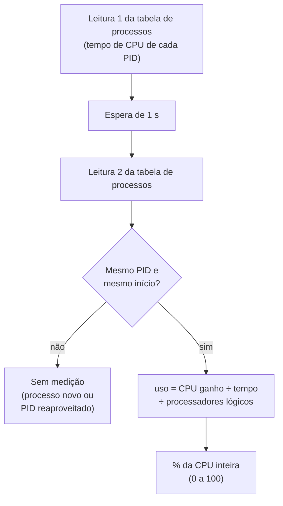
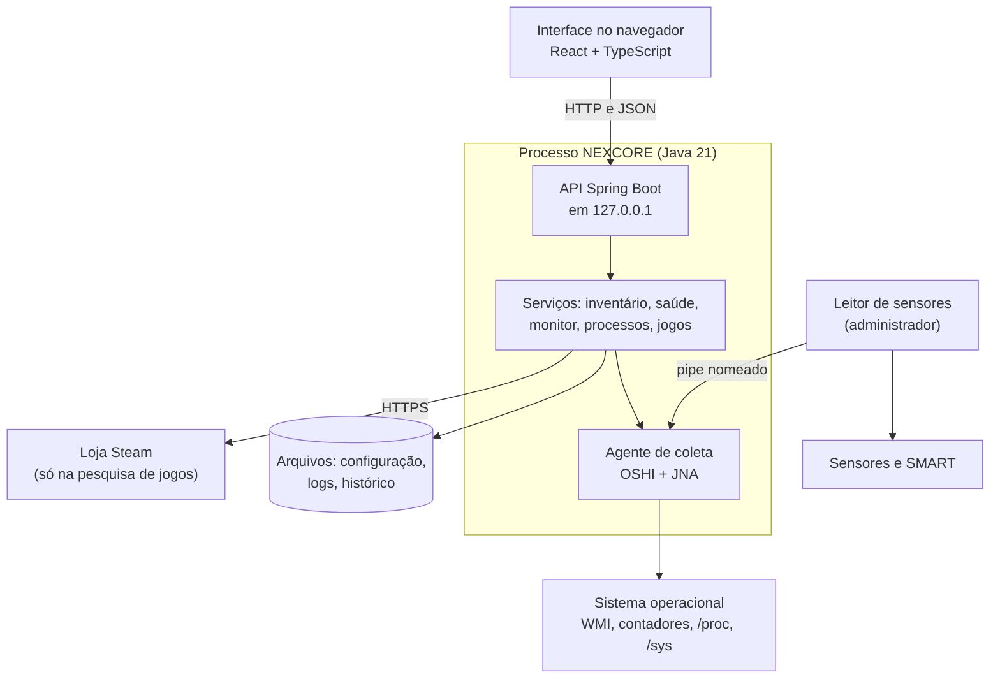
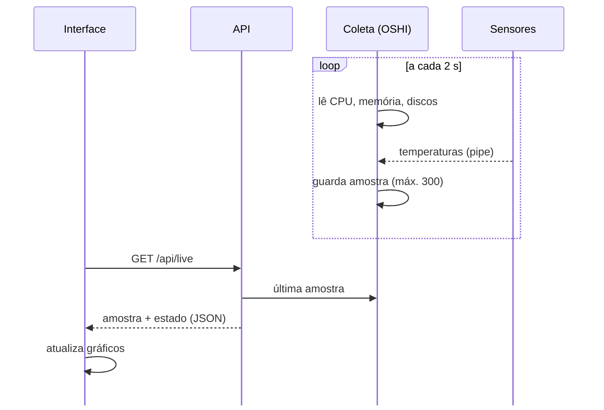
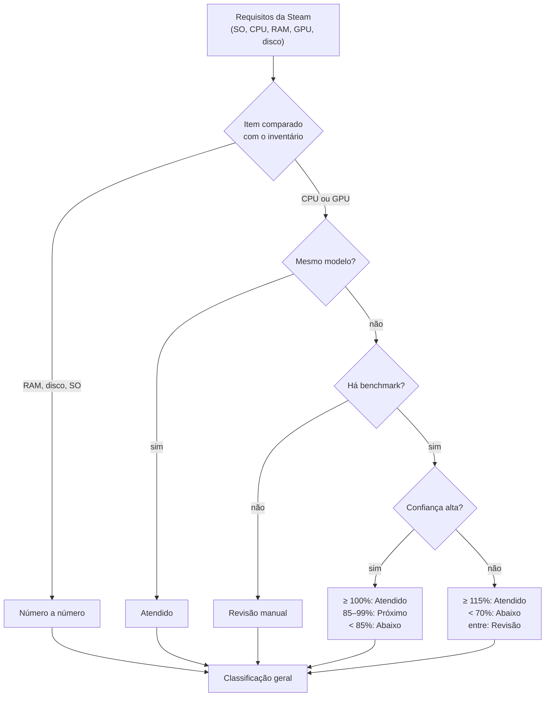
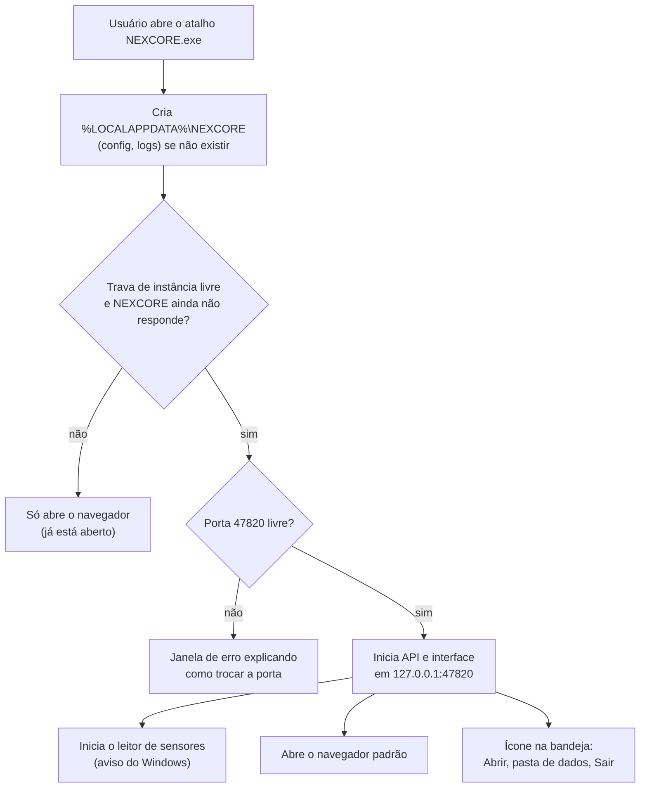
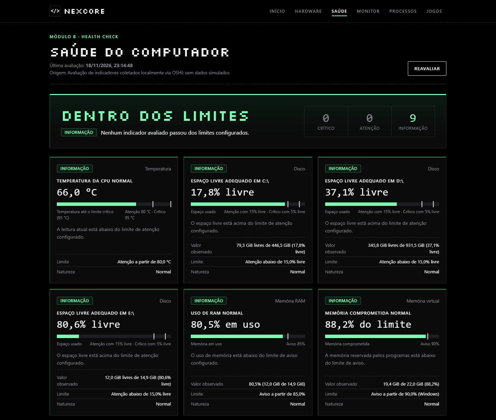
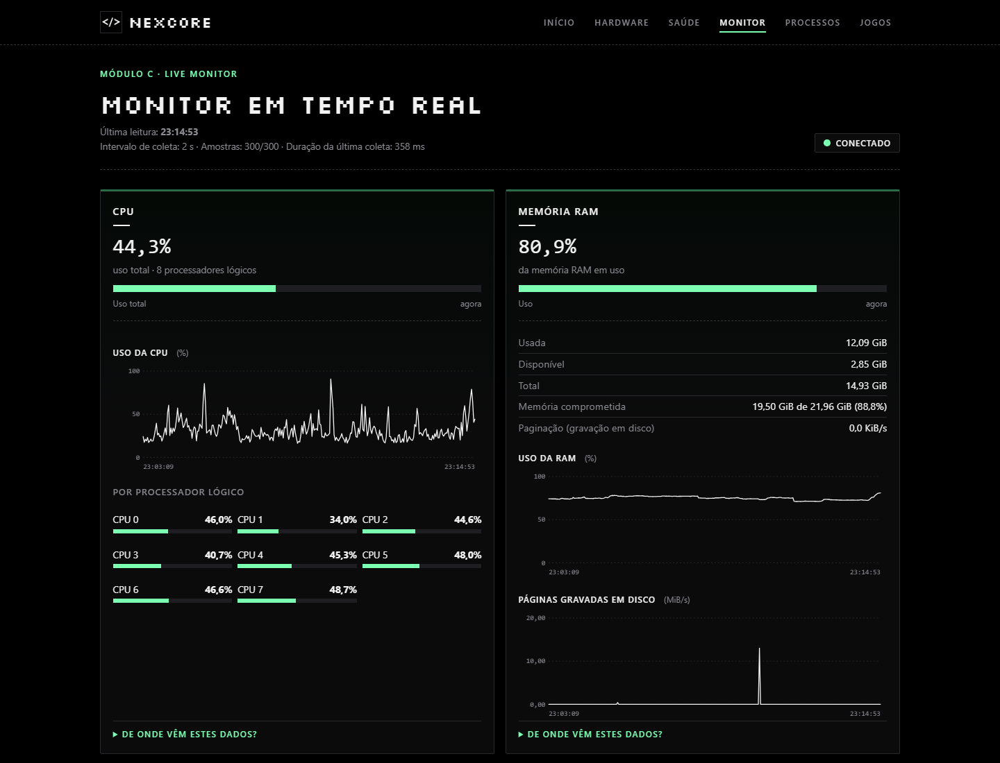
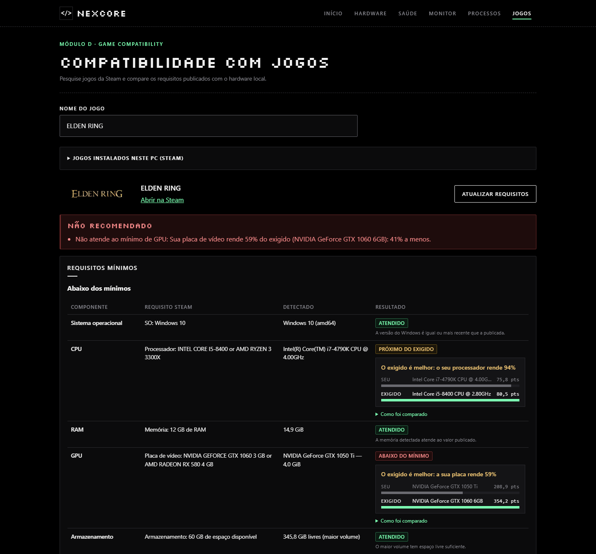
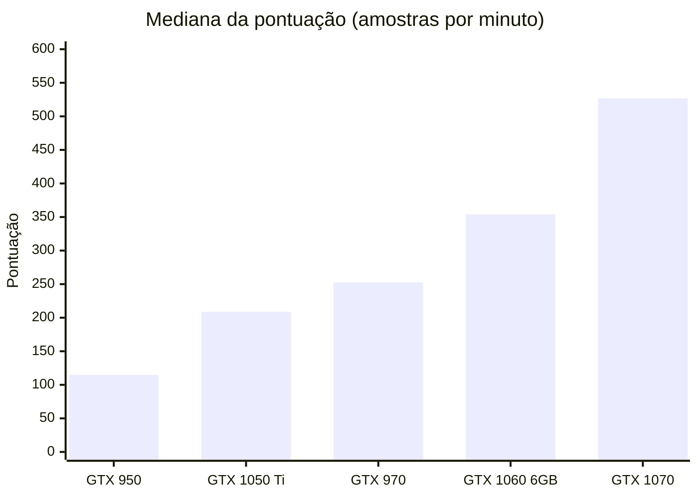

<!--
  Documentação do projeto NEXCORE no modelo de trabalho acadêmico da FATEC (ABNT).
  Esta é a fonte do documento Word (docs/NEXCORE-documentacao.docx), gerado por docs/doc-build/gerar-docx.js.
  Diagramas em Mermaid; no Word eles aparecem como imagens geradas a partir deste mesmo código.
-->

# NEXCORE: aplicação de conceitos de Sistemas Operacionais no monitoramento e diagnóstico de hardware

**Análise e Desenvolvimento de Sistemas — FATEC Itapetininga**
Disciplina: Sistemas Operacionais · Orientador (a): Deivison S. Takatu
Integrantes: Gabriel, Karl, Marcos, Enzo e Vinicius · Itapetininga, SP, 2026
Versão do software documentada: **NEXCORE 4.0.0**

## RESUMO

Descobrir o que existe dentro de um computador, se ele está funcionando dentro de limites seguros e se ele atende aos requisitos de um jogo costuma exigir várias ferramentas diferentes e conhecimento técnico para interpretar números sem contexto. Este trabalho apresenta o NEXCORE, uma aplicação local para Windows e Linux que reúne essas respostas em uma única interface e explica a origem de cada dado. O software identifica os componentes de hardware, avalia a saúde do computador (temperatura, espaço em disco, memória e saúde SMART dos discos), monitora CPU, memória, GPU, sensores e discos em tempo real, lista os processos em execução e compara o hardware local com os requisitos publicados na loja Steam, inclusive entre modelos diferentes de processador e placa de vídeo, por meio de dados públicos de benchmark. O desenvolvimento seguiu um processo incremental, versionado com Git e GitHub, com testes automatizados em cada módulo. O projeto aplica, na prática, conceitos de Sistemas Operacionais como gerenciamento e medição de processos e threads, memória virtual e paginação, sistema de arquivos e permissões, variáveis de ambiente, execução de comandos do sistema, agendamento de tarefas, comunicação entre processos por pipe nomeado e controle de privilégios. Como resultado, a versão 4.0.0 é distribuída por um instalador próprio, funciona sem exigir ferramentas de desenvolvimento no computador do usuário e foi validada com 403 testes automatizados e verificações ponta a ponta em hardware real. Conclui-se que um conjunto pequeno de conceitos de Sistemas Operacionais, bem aplicados e explicados, permite construir uma ferramenta útil e transparente, que nunca apresenta valores simulados como medições reais.

**Palavras-chave:** Sistemas Operacionais; Monitoramento de Hardware; Gerenciamento de Processos.

## ABSTRACT

Finding out what is inside a computer, whether it is operating within safe limits and whether it meets the requirements of a game usually requires several different tools and technical knowledge to interpret numbers without context. This paper presents NEXCORE, a local application for Windows and Linux that brings these answers together in a single interface and explains where each piece of data comes from. The software identifies hardware components, evaluates the computer's health (temperature, disk space, memory and SMART disk health), monitors CPU, memory, GPU, sensors and disks in real time, lists running processes and compares the local hardware with the requirements published on the Steam store, including between different processor and graphics card models, using public benchmark data. Development followed an incremental process, versioned with Git and GitHub, with automated tests in every module. The project applies, in practice, Operating Systems concepts such as process and thread management and measurement, virtual memory and paging, file system and permissions, environment variables, execution of system commands, task scheduling, inter-process communication through named pipes and privilege control. As a result, version 4.0.0 is distributed through its own installer, works without requiring development tools on the user's computer and was validated with 403 automated tests and end-to-end checks on real hardware. It is concluded that a small set of Operating Systems concepts, well applied and explained, makes it possible to build a useful and transparent tool that never presents simulated values as real measurements.

**Keywords:** Operating Systems; Hardware Monitoring; Process Management.

# 1 INTRODUÇÃO

## 1.1. Contextualização do Problema

O computador pessoal é uma combinação de componentes (processador, memória, placa de vídeo, discos e placa-mãe) cujo estado muda o tempo todo: a carga da CPU varia a cada segundo, a memória disponível depende dos programas abertos, o espaço livre dos discos diminui com o uso e a temperatura sobe com o esforço. Todas essas informações existem no sistema operacional, que é quem gerencia os recursos da máquina, mas estão espalhadas em ferramentas diferentes: o Gerenciador de Tarefas mostra processos e uso de recursos, o Gerenciador de Dispositivos mostra os componentes, as propriedades de cada disco mostram o espaço livre e as temperaturas só aparecem em programas de terceiros.

Para o usuário comum, a dificuldade não é apenas encontrar os dados, mas interpretá-los. Um valor de 70 °C na CPU é preocupante? Um disco com 18% de espaço livre exige atenção? Um processador Intel Core i7-4790K atende a um jogo que pede um Intel Core i5-8400? Esta última pergunta é especialmente comum: as lojas de jogos publicam requisitos mínimos e recomendados citando modelos específicos de processador e placa de vídeo, e comparar modelos de gerações e fabricantes diferentes exige consultar tabelas de desempenho que o usuário raramente conhece.

Há ainda um problema de confiança: muitas ferramentas exibem valores estimados ou preenchem com zero o que não conseguiram medir, e o usuário não tem como diferenciar uma medição real de uma ausência de dado. Para um diagnóstico, essa diferença é essencial: "o sistema não informou a temperatura" é muito diferente de "a temperatura é zero".

## 1.2. Justificativa e Objetivos

O NEXCORE foi desenvolvido para reunir em uma única aplicação local as informações de hardware, saúde, uso de recursos e compatibilidade com jogos, sempre explicando de onde vem cada dado e nunca apresentando valores simulados como medições reais. A escolha do tema se justifica pela relação direta com a disciplina de Sistemas Operacionais: todas as informações exibidas são obtidas consultando interfaces do próprio sistema operacional (contadores de desempenho, tabelas de processos, sistema de arquivos, registros do Windows, arquivos especiais do Linux em `/proc` e `/sys`), e o funcionamento da aplicação depende de mecanismos clássicos da disciplina, como processos, threads, memória virtual, permissões, agendamento de tarefas e comunicação entre processos.

**Objetivo geral:** desenvolver uma aplicação local, funcional e documentada que identifique, monitore e diagnostique os recursos de hardware de um computador e os relacione com os requisitos de jogos, aplicando e explicando conceitos de Sistemas Operacionais.

**Objetivos específicos já alcançados na versão 4.0.0:**

- identificar sistema operacional, processador, memória, placas de vídeo, placa-mãe, discos e volumes, indicando a fonte de cada dado no Windows e no Linux;
- avaliar a saúde do computador com limites configuráveis e alertas explicados, incluindo a saúde SMART dos discos;
- monitorar CPU, memória, paginação, GPU, temperaturas, ventoinhas e discos em tempo real, com gráficos;
- listar os processos em execução com uso de CPU, memória, threads e prioridade;
- registrar coletas periódicas por meio do agendador do sistema operacional;
- comparar o hardware local com os requisitos da Steam, dizendo qual componente é melhor e por quanto;
- distribuir a aplicação por um instalador que não exige ferramentas de desenvolvimento.

**Objetivos planejados e ainda não implementados** estão descritos na seção 5.3 e não fazem parte do estado atual do software.

Os benefícios esperados são: economia de tempo para o usuário, que encontra as respostas em um só lugar; decisões mais seguras antes de comprar ou instalar um jogo; e maior compreensão de como o sistema operacional gerencia os recursos, já que cada tela explica o significado dos dados.

## 1.3. Metodologia Utilizada

O projeto foi desenvolvido de forma incremental, em versões pequenas e testáveis, registradas no histórico de versões do repositório (`docs/CHANGELOG.md`) e no Git. Cada versão seguiu o mesmo ciclo: definição do objetivo e dos critérios de aceite; implementação em uma branch própria; testes automatizados e verificação manual com dados reais do computador de desenvolvimento; atualização da documentação; e integração à branch principal somente após revisão. As etapas foram:

- **Estrutura e coleta (V0.1 a V0.3):** estrutura do repositório, agente de coleta e identificação do hardware.
- **Módulos principais (V0.4 a V1.0):** interface do inventário, diagnósticos de saúde e monitoramento em tempo real.
- **Compatibilidade com jogos (V1.1 a V2.3):** integração com a Steam, interpretação de requisitos e classificação geral.
- **Diagnósticos avançados (V2.4 a V2.9):** pressão de memória, origem dos dados, coleta agendada, saúde dos discos, jogos instalados, pré-checagem e comparação por benchmark.
- **Interface e processos (V3.0 a V3.2):** nova identidade visual, tela de processos e comparação simplificada.
- **Identidade e distribuição (V4.0.0):** nome NEXCORE, logotipo e instalador para Windows.

O cronograma detalhado está no Apêndice A. A validação usou o próprio computador de desenvolvimento (processador Intel Core i7-4790K, placa de vídeo NVIDIA GeForce GTX 1050 Ti, SSD SATA, HDD SATA e um pendrive USB), conferindo os valores com as ferramentas do próprio Windows, conforme o procedimento de conferência manual descrito no README.

# 2 FUNDAMENTAÇÃO TEÓRICA

## 2.1. Estudos e Pesquisas Relacionadas ao Problema

Tanenbaum e Bos (2016) descrevem o sistema operacional como a camada de software que gerencia os recursos do computador e oferece aos programas abstrações mais simples do que o hardware: processos no lugar do processador, espaços de endereçamento no lugar da memória física e arquivos no lugar dos blocos do disco. Silberschatz, Galvin e Gagne (2015) destacam que, além de gerenciar recursos, o sistema operacional mantém informações contábeis sobre seu uso, como o tempo de CPU consumido por processo e a ocupação da memória e dos discos. É exatamente dessas informações contábeis que um monitor de recursos depende: o NEXCORE não mede o hardware diretamente, mas consulta o que o sistema operacional já registra.

No Linux, essas informações são expostas como arquivos virtuais em `/proc` e `/sys` (KERRISK, 2026), seguindo o princípio de que "tudo é arquivo". No Windows, elas vêm de contadores de desempenho, do WMI (*Windows Management Instrumentation*) e de chamadas da API do sistema. A biblioteca OSHI (OSHI, 2026) unifica essas fontes em uma interface Java independente do sistema operacional, o que permitiu escrever o mesmo código de coleta para os dois sistemas.

Algumas informações, porém, não são expostas pelo sistema operacional de forma padronizada: temperaturas, rotação das ventoinhas e indicadores SMART dos discos exigem leitura de registradores e comandos específicos de cada fabricante, normalmente com privilégios de administrador. O projeto LibreHardwareMonitor (LIBREHARDWAREMONITOR, 2026) reúne essas leituras em uma biblioteca de código aberto, usada pelo NEXCORE em um processo separado e elevado, assunto da seção 2.2.

Para a comparação entre processadores e placas de vídeo de modelos diferentes, era necessária uma fonte pública, verificável e de licença livre. O Blender Open Data (BLENDER FOUNDATION, 2026) publica os resultados de um benchmark de renderização executado por usuários de todo o mundo, sob a licença CC0 (domínio público), com milhares de execuções por modelo. Essa base foi escolhida por ser aberta e reproduzível, com a ressalva, documentada no próprio software, de que mede desempenho de renderização e não desempenho em jogos.

## 2.2 Conceitos-chave

### Conceitos de Sistemas Operacionais aplicados

O Quadro 1 relaciona cada conceito de Sistemas Operacionais com o ponto do NEXCORE em que ele é aplicado. Os conceitos foram escolhidos porque são indispensáveis para a funcionalidade correspondente, e não apenas para fins de demonstração.

Quadro 1 - Conceitos de Sistemas Operacionais aplicados no NEXCORE

| Conceito | Onde aparece | Como é aplicado |
|---|---|---|
| Processos e threads | Tela Processos (`ProcessService`, `ProcessSampler`) | Lista os processos com PID, PID do processo pai, threads, prioridade, estado, dono e memória. O uso de CPU de cada processo é calculado com duas leituras com 1 s de intervalo |
| Escalonamento e prioridade | Tela Processos | Mostra a prioridade base do Windows (8 = normal) e o *nice* do Linux, explicando ao usuário o papel do escalonador |
| Uso de CPU | Monitor e Início | Carga total e por processador lógico, calculada pela diferença dos contadores de tempo de CPU (ocioso, usuário, sistema) entre duas leituras |
| Memória física e virtual | Hardware, Saúde e Monitor | Memória em uso e disponível, arquivo de paginação (*swap*), memória comprometida e páginas gravadas em disco por segundo, com alerta de paginação sustentada |
| Sistema de arquivos e armazenamento | Hardware, Saúde e Monitor | Volumes, sistema de arquivos (NTFS, exFAT), espaço livre, ligação de cada volume ao disco físico e taxas de leitura e escrita |
| Arquivos, diretórios e permissões | Histórico (`HistoryStore`) | Um arquivo JSON Lines por dia, retenção de 7 dias e gravação sob trava exclusiva de arquivo. No Linux, pasta com permissão `700` e arquivos com `600` |
| Variáveis de ambiente | Agente e backend (`Env`) | `NEXCORE_DATA_DIR`, `NEXCORE_RETENCAO_DIAS` e `NEXCORE_STEAM_DIR` alteram o comportamento sem recompilar o software |
| Execução de comandos do sistema | `CommandRunner` | Executa `schtasks`, `powercfg` e `crontab` com argumentos fixos e tempo limite de 5 s, lendo o código de saída |
| Agendamento de tarefas | Scripts `agendar-coleta` | Registra no Agendador de Tarefas do Windows ou no `cron` do Linux uma coleta periódica que roda com o NEXCORE fechado |
| Comunicação entre processos (IPC) | Leitor de sensores | O backend inicia o leitor de sensores, que envia as leituras por um pipe nomeado de nome aleatório e encerra quando o processo pai termina |
| Privilégios e controle de acesso | Leitor de sensores e instalador | Somente o leitor de sensores roda como administrador (aviso do Controle de Conta de Usuário, UAC); a aplicação principal roda sem privilégios |
| Exclusão mútua | Versão instalada (`NexcoreLauncher`) | Uma trava de arquivo garante uma única instância por usuário |

Fonte: elaborado pelos autores.

### Processos e medição de CPU por processo

O sistema operacional mantém, para cada processo, o tempo de CPU gasto em modo usuário e em modo núcleo (*kernel*). Esse tempo é cumulativo: um número isolado não indica se o processo está ativo agora. Por isso o NEXCORE faz duas leituras da tabela de processos com 1 s de intervalo e calcula o uso no intervalo, conforme a Figura 1. O resultado é dividido pelo número de processadores lógicos, para que um processo que ocupe totalmente dois de oito núcleos apareça com 25% da CPU, e não com 200%. Um processo que surgiu entre as duas leituras, ou cujo PID foi reaproveitado por outro processo (início diferente), fica sem medição, em vez de receber um valor inventado.

Figura 1 - Cálculo do uso de CPU de um processo



Fonte: elaborada pelos autores.

### Memória virtual e paginação

A memória virtual permite que os programas reservem mais memória do que a física disponível, usando o disco (arquivo de paginação no Windows, *swap* no Linux) como extensão. Silberschatz, Galvin e Gagne (2015) mostram que, quando a memória física fica insuficiente, o sistema passa a gravar páginas em disco continuamente, o que degrada o desempenho. O NEXCORE mede três indicadores relacionados: a **memória comprometida** (quanto os programas reservaram, comparado ao limite formado pela memória física somada ao arquivo de paginação), a **ocupação do arquivo de paginação** e as **páginas gravadas em disco por segundo**. A Saúde só aponta "paginação sustentada" quando a média de gravação passa de 1 MiB/s em uma janela de 30 amostras **e** a memória física está acima do limite de aviso, para não confundir uma gravação pontual com falta de memória.

### Comunicação entre processos e privilégios

As leituras de temperatura e SMART exigem privilégios de administrador. Executar toda a aplicação como administrador ampliaria o risco: qualquer falha na interface ou na API teria acesso total ao sistema. O NEXCORE isola esse privilégio em um processo pequeno e separado, o leitor de sensores (`NEXCORE.SensorHost.exe`), que é iniciado com o verbo `runas` (aviso do UAC) e devolve as leituras por um **pipe nomeado**, um mecanismo de comunicação entre processos do Windows (MICROSOFT, 2026a). O nome do pipe é aleatório a cada execução e o leitor monitora o processo que o iniciou: quando o NEXCORE termina, o leitor também termina, sem deixar processos elevados para trás.

### Tecnologias e decisões de arquitetura

A interface foi construída como uma aplicação web local em React, servida no endereço `127.0.0.1`, o que dispensa instalar uma interface gráfica específica para cada sistema operacional e permite usar o navegador que o usuário já tem. A API foi escrita em Java com Spring Boot, que já oferece servidor HTTP embutido, injeção de dependências e configuração externa. A versão de cada tecnologia está no Quadro 5 (seção 3.2). O versionamento usou Git e GitHub, com uma branch por funcionalidade e integração à branch principal após revisão.

## 2.3 Soluções já existentes e lacunas identificadas

O Quadro 2 resume as soluções mais conhecidas que tratam de parte do problema e as lacunas observadas em relação à proposta do NEXCORE.

Quadro 2 - Soluções existentes e lacunas

| Solução | O que oferece | Lacunas em relação à proposta |
|---|---|---|
| Gerenciador de Tarefas (Windows) | Processos, uso de CPU, memória, disco e GPU | Não mostra temperaturas nem saúde SMART; não explica limites; não compara com requisitos de jogos |
| HWiNFO, CPU-Z e similares | Inventário detalhado e todos os sensores | Muitos números sem interpretação; sem diagnóstico explicado; sem relação com requisitos de jogos |
| Sites do tipo "vai rodar?" | Comparação de requisitos de jogos | Exigem informar o hardware manualmente ou instalar um detector; critérios de comparação pouco transparentes |
| `top`, `htop`, `free`, `df` (Linux) | Processos, memória e disco no terminal | Exigem conhecimento técnico; ferramentas separadas; sem histórico com a máquina desligada |

Fonte: elaborado pelos autores.

A lacuna comum é a **interpretação**: as ferramentas existentes mostram dados, mas raramente explicam se o valor é bom ou ruim, de onde ele vem e o que fazer. O NEXCORE se diferencia por reunir as respostas em um só lugar, mostrar a origem de cada dado no Windows e no Linux, comparar com limites explícitos e configuráveis, distinguir "não disponível" de "falha de coleta" e, na compatibilidade com jogos, dizer em linguagem direta qual componente é melhor e por quanto, citando a fonte e a confiança da comparação.

# 3 REQUISITOS E PROPOSTA DA SOLUÇÃO

## 3.1. Levantamento de Requisitos

Os requisitos foram levantados a partir do problema descrito na seção 1.1 e refinados a cada versão, com base nos testes com hardware real. Os requisitos funcionais estão no Quadro 3 e os não funcionais no Quadro 4. Todos estão implementados na versão 4.0.0.

Quadro 3 - Requisitos funcionais

| Código | Requisito |
|---|---|
| RF01 | Identificar sistema operacional, CPU, memória, placas de vídeo, placa-mãe, discos e volumes |
| RF02 | Informar a origem de cada dado no Windows e no Linux |
| RF03 | Avaliar temperatura da CPU, espaço livre, uso de memória, pressão de memória e saúde SMART, com limites configuráveis |
| RF04 | Monitorar CPU, memória, GPU, sensores e discos em tempo real, com gráficos dos últimos minutos |
| RF05 | Listar os processos em execução com CPU, memória, threads e prioridade, com filtro, agrupamento e ordenação |
| RF06 | Registrar coletas periódicas com o software fechado e exibir o histórico |
| RF07 | Pesquisar jogos na Steam e obter os requisitos mínimos e recomendados |
| RF08 | Comparar os requisitos com o hardware local e classificar a compatibilidade |
| RF09 | Comparar CPU e GPU de modelos diferentes por benchmark, informando qual é melhor e por quanto |
| RF10 | Listar os jogos Steam instalados e verificar o estado do computador antes de jogar |
| RF11 | Instalar, abrir, atualizar e desinstalar o software no Windows sem ferramentas de desenvolvimento |

Fonte: elaborado pelos autores.

Quadro 4 - Requisitos não funcionais

| Código | Requisito |
|---|---|
| RNF01 | Nunca apresentar valor simulado ou estimado como medição real; diferenciar "não disponível" de "falha de coleta" |
| RNF02 | Aceitar conexões somente do próprio computador (`127.0.0.1`) |
| RNF03 | Não alterar configurações do sistema nem encerrar processos (somente leitura) |
| RNF04 | Exigir privilégios de administrador somente onde forem indispensáveis (leitura de sensores) |
| RNF05 | Não bloquear a interface durante as coletas (coleta em segundo plano) |
| RNF06 | Funcionar em Windows 10 1903 ou mais novo (64 bits) e em Linux |
| RNF07 | Interface acessível: contraste mínimo de 3:1 nos campos, foco visível e animações desligadas quando o sistema pede menos movimento (W3C, 2018) |
| RNF08 | Preservar a configuração e os dados do usuário em atualizações |

Fonte: elaborado pelos autores.

## 3.2. Proposta de Solução e Justificativa Técnica

A solução proposta é uma aplicação local dividida em quatro partes com responsabilidades separadas: o **agente de coleta**, que conversa com o sistema operacional; a **API**, que organiza, avalia e entrega os dados; o **leitor de sensores**, isolado por exigir privilégios; e a **interface**, que apresenta e explica as informações. Essa divisão permite testar cada parte separadamente, manter o privilégio de administrador restrito a um processo pequeno e trocar a interface sem alterar a coleta.

### Funcionalidades

A seguir, cada funcionalidade é descrita pelo que faz, pelo problema que resolve, pelo funcionamento, pelos dados e tecnologias usados e pelas limitações.

**Identificação de hardware (tela Hardware, `GET /api/inventory`).** Mostra sistema operacional (nome, versão, build, arquitetura e tempo ligado), processador (modelo, fabricante, núcleos físicos, processadores lógicos, frequências e uso no momento), memória (total, em uso, disponível, paginação e memória comprometida), placas de vídeo (nome, fabricante, identificador e memória de vídeo), placa-mãe (fabricante, modelo, versão, número de série e modelo do computador) e armazenamento (discos com modelo, capacidade, tipo SSD ou HDD, barramento e volumes de cada disco). Resolve a necessidade de conhecer o computador sem abrir o gabinete nem usar várias ferramentas. Funciona pelo agente, com a OSHI. Cada componente é coletado separadamente e tem estado próprio (OK, não disponível ou falha), de modo que a falha em um não afeta os outros. Campos que o fabricante deixou com texto genérico (ex.: "To be filled by O.E.M.") aparecem como "Não informado pelo fabricante". Limitação: a memória de vídeo informada pelo Windows não distingue memória dedicada de compartilhada e pode ficar limitada a 4 GiB; o tipo SSD/HDD só aparece quando o sistema o informa, sem dedução pelo nome do modelo.

**Origem dos dados ("De onde vêm estes dados?").** Cada card e painel tem uma tabela que mostra, para cada campo, a fonte no Windows (registro, WMI, contadores de desempenho, APIs do sistema) e no Linux (`/proc`, `/sys`, comandos como `lspci` e `lsblk`), com destaque para o sistema em uso. Resolve a falta de transparência sobre a procedência dos dados e tem valor didático para a disciplina. Um teste automatizado garante que todo campo exibido tenha fonte cadastrada.

**Saúde do computador (tela Saúde, `GET /api/health-check`).** Avalia a temperatura da CPU, o espaço livre de cada volume, o uso de memória, a memória comprometida, a paginação sustentada e a saúde SMART de cada disco (vida útil restante, temperatura, horas ligado e dados gravados). Cada indicador gera um alerta com severidade (informação, atenção ou crítico), natureza (normal, preventivo ou dado indisponível), valor observado e limite aplicado. Na tela, cada alerta tem o valor em destaque e uma régua até o limite. Resolve a interpretação dos números. Os limites são padrões genéricos do projeto, configuráveis, e aparecem na Tabela 1. Limitações: os limites não são oficiais dos fabricantes; o SMART não inclui setores realocados nem erros de leitura; temperatura e SMART exigem o leitor de sensores com privilégio de administrador.

Tabela 1 - Limites padrão da Saúde (configuráveis)

| Indicador | Atenção | Crítico |
|---|---|---|
| Temperatura da CPU | 80 °C | 95 °C |
| Espaço livre por volume | abaixo de 15% | abaixo de 5% |
| Memória em uso | a partir de 85% | — |
| Memória comprometida (Windows) | a partir de 90% | — |
| Paginação sustentada | média a partir de 1 MiB/s com memória acima de 85% | — |
| Vida útil restante do disco (SMART) | 20% ou menos | 5% ou menos |
| Temperatura do disco | HDD a partir de 55 °C; SSD a partir de 70 °C | — |

Fonte: elaborada pelos autores a partir de `application.properties`.

**Monitor em tempo real (tela Monitor, `GET /api/live` e `/api/live/history`).** Mostra CPU (total e por processador lógico), memória, paginação, GPU (utilização, memória de vídeo e temperatura), temperaturas, ventoinhas e discos (leitura, escrita, tempo ocupado e espaço dos volumes), com gráficos das últimas 300 amostras. Resolve o acompanhamento do comportamento do computador ao longo do tempo. Uma thread em segundo plano coleta a cada 2 s e guarda as amostras em memória; a interface consulta a API no mesmo ritmo e desenha gráficos em SVG próprios, sem biblioteca externa. Leituras ausentes geram lacunas no gráfico, nunca valores preenchidos. Limitação: o histórico do Monitor fica só na memória e se perde ao fechar o software.

**Processos (tela Processos, `GET /api/processes`).** Lista os processos com PID, uso de CPU, memória física, threads, prioridade, tempo em execução e dono, com agrupamento por nome (como o Gerenciador de Tarefas), filtro, ordenação por coluna e atualização a cada 5 s. Mostra também os totais de processos e threads e os maiores consumidores de CPU e memória, além de um quadro que explica processo, PID, thread, prioridade, memória e CPU. Funciona como descrito na seção 2.2. É somente leitura: não existe rota para encerrar ou alterar processos. Limitações: no Windows o estado de todos os processos é informado como "em execução", por isso a coluna Estado só aparece no Linux; o dono de processos do sistema só é informado com privilégio de administrador.

**Histórico (coleta agendada, `GET /api/history`).** Os scripts `agendar-coleta` registram no agendador do sistema uma coleta a cada N minutos (padrão: 15). A cada execução, o agente grava uma linha JSON no arquivo do dia e termina. A página do Histórico mostra CPU, memória, paginação, memória comprometida e espaço livre por volume ao longo dos dias, com lacunas nos períodos sem coleta. Resolve a necessidade de observar o computador mesmo com o NEXCORE fechado. Limitação: a coleta agendada não lê temperaturas, porque roda sem privilégio de administrador.

**Compatibilidade com jogos (tela Jogos, `GET /api/games/...`).** O usuário pesquisa um jogo pelo nome; o NEXCORE consulta a loja Steam, interpreta os requisitos mínimos e recomendados publicados (sistema operacional, processador, memória, placa de vídeo, armazenamento e exigência de SSD) e compara cada item com o hardware local. Memória, armazenamento e versão do Windows são comparados número a número. Processadores e placas de vídeo são comparados pelo modelo: se o modelo local é um dos publicados, atende; se é outro, a comparação usa o benchmark do Blender Open Data, como mostra a Figura 4 (seção 3.3). O resultado de cada item é "Atendido", "Abaixo do mínimo", "Próximo do exigido", "Revisão manual" ou "Dados insuficientes", e o jogo recebe uma classificação geral: "Compatível", "Compatibilidade limitada", "Não recomendado" ou "Dados insuficientes". A tela mostra, para cada comparação por benchmark, as duas pontuações lado a lado e uma frase direta como "O exigido é melhor: o seu processador rende 94%". Resolve a pergunta "vai rodar?" com critérios transparentes. Limitações: o benchmark mede renderização, não FPS em jogos; o resultado não garante desempenho; requisitos genéricos (ex.: "Intel Core i5") ficam para revisão manual.

**Jogos instalados e pré-checagem.** O NEXCORE localiza a pasta da Steam (registro do Windows ou pastas padrão do Linux), lê os arquivos de bibliotecas (`libraryfolders.vdf`) e de cada jogo (`appmanifest_*.acf`) e lista os jogos instalados com tamanho, disco e tipo SSD/HDD. A pré-checagem antes de jogar verifica memória disponível, uso de CPU e programas que mais consomem recursos, atualização pendente do jogo, espaço livre no disco do jogo, jogo que pede SSD instalado em HDD, plano de energia (pelo comando `powercfg`) e uso da bateria. O identificador da conta Steam nunca é lido.

**Instalação e versão instalada.** O instalador cria a instalação, atalhos e o registro em "Aplicativos instalados"; o `NEXCORE.exe` inicia tudo, abre o navegador e fica na bandeja do Windows. Detalhes nas seções 3.3 e 3.5.

### Tecnologias utilizadas

O Quadro 5 lista as tecnologias efetivamente presentes no repositório, com as versões declaradas nos arquivos de configuração (`pom.xml`, `package.json` e `NEXCORE.SensorHost.csproj`).

Quadro 5 - Tecnologias utilizadas

| Categoria | Tecnologia (versão) | Finalidade e justificativa |
|---|---|---|
| Interface | React 19 com TypeScript 7 | Componentes reutilizáveis e tipagem dos dados da API |
| Interface | Vite 8 | Servidor de desenvolvimento e compilação da interface |
| Interface | Fonte Silkscreen (licença OFL) | Títulos da identidade visual, incluída no projeto para funcionar sem internet |
| API | Java 21 e Spring Boot 3.3.5 | Servidor HTTP embutido, injeção de dependências e configuração externa |
| Coleta | OSHI 6.6.5 e JNA 5.15.0 | Acesso unificado às informações do Windows e do Linux, e chamadas nativas do sistema |
| Sensores | C# (.NET Framework 4.8) e LibreHardwareMonitorLib 0.9.6 | Temperaturas, ventoinhas, GPU e SMART, em um processo separado e elevado |
| Integrações externas | Loja Steam e Blender Open Data | Requisitos dos jogos e dados públicos de desempenho (CC0) |
| Testes | JUnit 5, Mockito, Vitest 5 e Testing Library | Testes automatizados do agente, da API e da interface |
| Qualidade | oxlint | Análise estática do código da interface |
| Build | Maven 3.9 e npm | Compilação e dependências do Java e da interface |
| Distribuição | jpackage e jlink (JDK 21), Inno Setup 6.7 | Executável com Java embutido e instalador para Windows |
| Automação | Shell Script e arquivos `.bat` | Execução, coleta agendada, verificações e build |
| Versionamento | Git e GitHub | Histórico, branches por funcionalidade e publicação das versões |

Fonte: elaborado pelos autores.

## 3.3. Arquitetura da Solução

A Figura 2 mostra a arquitetura geral. O navegador acessa somente a API local; a API usa o agente, que está no mesmo processo, para consultar o sistema operacional, e recebe as leituras de sensores do leitor elevado por pipe nomeado. As únicas conexões externas são com a loja Steam, feitas pela API apenas quando o usuário pesquisa um jogo.

Figura 2 - Arquitetura geral do NEXCORE



Fonte: elaborada pelos autores.

A comunicação entre os módulos segue a sequência da Figura 3. Os dados de cada tela são buscados pela interface em endpoints próprios, listados no Quadro 6, e todas as respostas são JSON com um estado por componente, para que a interface diferencie dado presente, dado ausente e falha.

Figura 3 - Comunicação entre os módulos em uma consulta do Monitor



Fonte: elaborada pelos autores.

Quadro 6 - Endpoints da API local

| Endpoint | Função |
|---|---|
| `GET /api/ping` | Estado, nome e versão (`NEXCORE 4.0.0`) |
| `GET /api/inventory` | Inventário de hardware |
| `GET /api/health-check` | Alertas de saúde com valor e limite |
| `GET /api/live` e `/api/live/history` | Última amostra e histórico em memória do Monitor |
| `GET /api/processes` | Processos em execução (somente leitura) |
| `GET /api/history?days=N` | Histórico da coleta agendada (1 a 30 dias) |
| `GET /api/games/search?query=...` | Pesquisa de jogos na Steam |
| `GET /api/games/{appId}/requirements` | Requisitos mínimos e recomendados |
| `GET /api/games/{appId}/compatibility` | Comparação com o hardware local |
| `GET /api/games/installed` | Jogos Steam instalados |
| `GET /api/games/{appId}/precheck` | Pré-checagem antes de jogar |

Fonte: elaborado pelos autores.

A análise de compatibilidade segue o fluxo da Figura 4. As regras de comparação por benchmark são heurísticas do projeto, documentadas e testadas: a comparação é feita na mesma versão do Blender e no mesmo modo de renderização, preferindo um modelo do mesmo fabricante; placas de vídeo só são comparadas dentro da mesma geração; processadores também são comparados por núcleo físico, porque jogos dependem mais do desempenho de cada núcleo; e a confiança é "alta" quando há pelo menos 10 execuções de cada lado com pouca dispersão; a porcentagem é a pontuação local dividida pela pontuação do modelo exigido.

Figura 4 - Fluxo da análise de compatibilidade de um jogo



Fonte: elaborada pelos autores.

Na versão instalada, o ponto de entrada é o `NexcoreLauncher`, que segue o fluxo da Figura 5. A interface já compilada vai dentro do próprio programa, de modo que um único processo serve a interface e a API.

Figura 5 - Inicialização da versão instalada



Fonte: elaborada pelos autores.

### Estrutura do código

O repositório está organizado em módulos com responsabilidades separadas, descritos no Quadro 7.

Quadro 7 - Estrutura do repositório

| Diretório | Conteúdo e responsabilidade |
|---|---|
| `agent/` | Agente de coleta em Java: `collector/` (um coletor por componente: sistema, CPU, memória, GPU, placa-mãe, discos, sensores), `sensors/` (cliente do leitor de sensores e pipe nomeado), `history/` (arquivos do histórico e coleta agendada), `model/` (registros de dados) e `Env` (variáveis de ambiente) |
| `backend/` | API Spring Boot: `controller/` (endpoints), `service/` e `monitor/` (inventário, saúde, coleta periódica), `diagnostic/` (regras da Saúde), `processes/`, `history/`, `steam/` e `compatibility/` (jogos), `benchmark/` (tabela do Blender Open Data), `precheck/` e `launcher/` (versão instalada) |
| `sensor-host/` | Leitor de sensores em C# com a LibreHardwareMonitorLib |
| `frontend/` | Interface React: `pages/` (uma por tela), `modules/` (lógica e componentes de cada área), `components/` (cabeçalho, rodapé, cards, ícones, ilustrações), `services/` (chamadas à API) e `navigation.ts` (rotas por endereço) |
| `installer/` | Build da versão instalável (`build.ps1`), instalador (`nexcore.iss`) e licenças de terceiros |
| `branding/` | Logotipo oficial e recursos gerados (ícone, PNGs, imagens do instalador) |
| `scripts/` | Execução, coleta agendada, atualização dos benchmarks e testes da documentação |
| `tests/` | Verificações ponta a ponta do agente e da API |
| `docs/` | Documentação de projeto, APIs, processo, diagramas e histórico de versões |

Fonte: elaborado pelos autores.

As partes se relacionam em camadas. Na API, cada controlador recebe a requisição e chama um serviço; o serviço usa os coletores do agente e as regras de diagnóstico; a resposta volta como um registro (*record*) Java convertido em JSON. Na interface, cada tela usa um *hook* que chama um serviço, e o serviço valida o formato da resposta antes de entregá-la à tela, transformando falhas de rede ou de formato em mensagens claras para o usuário. Por exemplo, na tela de Processos: a página `ProcessesPage` usa o *hook* `useProcesses`, que chama `fetchProcesses` a cada 5 s, sempre esperando a leitura anterior terminar; no backend, o `ProcessController` chama o `ProcessService`, que lê a tabela de processos pelo OSHI e calcula o uso de CPU com o `ProcessSampler`.

## 3.4. Prototipação e Usabilidade

A identidade visual do NEXCORE foi definida a partir de uma referência de design minimalista e tecnológico, adaptada ao contexto do software: fundo preto, textos em branco e cinza, divisórias finas, uma única cor de destaque (verde) reservada a estados e itens ativos e uma fonte pixelada usada apenas em títulos. O logotipo oficial, mostrado na Figura 6, é o símbolo `< / >` em branco sobre fundo preto. Ele aparece no cabeçalho da interface, na aba do navegador, no instalador e no ícone do programa.

Figura 6 - Logotipo oficial do NEXCORE


Fonte: elaborada pelos autores.

A navegação usa um cabeçalho fixo com as telas Início, Hardware, Saúde, Monitor, Processos e Jogos; em telas estreitas, a navegação abre pelo botão "Menu". Cada tela tem endereço próprio, o que permite usar o botão Voltar do navegador. A tela Início, na Figura 7, apresenta o software e mostra um resumo real do computador e leituras ao vivo.

Figura 7 - Tela Início


Fonte: captura de tela do NEXCORE, elaborada pelos autores.

A apresentação dos dados segue um padrão: cada card tem um valor em destaque, uma legenda curta e, quando há um percentual medido, uma régua; os detalhes ficam abaixo. Na Saúde, na Figura 8, cada alerta mostra o valor, a régua até o limite com as marcas de atenção e crítico e o estado geral em destaque.

Figura 8 - Tela Saúde



Fonte: captura de tela do NEXCORE, elaborada pelos autores.

O Monitor, na Figura 9, combina os valores atuais com gráficos dos últimos minutos. Os gráficos são desenhados em SVG pelo próprio projeto e mostram lacunas onde não houve leitura.

Figura 9 - Tela Monitor



Fonte: captura de tela do NEXCORE, elaborada pelos autores.

Na compatibilidade com jogos, a Figura 10 mostra uma comparação real: o processador local (Intel Core i7-4790K) ficou "Próximo do exigido" em relação ao Intel Core i5-8400 (94% do desempenho) e a placa de vídeo (GeForce GTX 1050 Ti) ficou abaixo da GeForce GTX 1060 exigida (59%), o que levou à classificação "Não recomendado".

Figura 10 - Tela Jogos com a comparação por benchmark



Fonte: captura de tela do NEXCORE, elaborada pelos autores.

A usabilidade foi trabalhada em ciclos curtos: cada tela foi conferida em telas de 1440 px e de 600 px de largura e ajustada a partir das observações dos integrantes durante o uso real. Alguns exemplos: as tabelas de requisitos foram reorganizadas para não exigir rolagem lateral; os cards da mesma linha passaram a ter a mesma altura; e a comparação por benchmark ganhou uma frase direta, porque os números isolados não deixavam claro qual componente era melhor. Também foram aplicados critérios de acessibilidade: atalho para pular para o conteúdo, foco visível, contraste mínimo de 3:1 nas bordas dos campos (W3C, 2018) e textos sempre junto das cores, para que nenhuma informação dependa só da cor.

## 3.5. Documentação do Projeto

A documentação acompanha o código no próprio repositório e foi atualizada a cada versão. O Quadro 8 resume os documentos e sua finalidade.

Quadro 8 - Documentação do projeto

| Documento | Finalidade |
|---|---|
| `README.md` | Visão geral, instalação para o usuário, execução para desenvolvimento, testes, configuração e estrutura |
| `docs/documentacao-de-projeto.md` e `docs/documentacao-requisitos-nexcore.md` | Objetivo, escopo, requisitos, arquitetura e limitações |
| `docs/documentacao-api.md` e `docs/api/` | Um documento por endpoint, com exemplos de resposta e limitações |
| `docs/diagramas.md` | Diagramas de arquitetura, do fluxo do Monitor e dos estados das métricas |
| `docs/processo-devops.md` | Ambiente, versionamento, testes e solução de problemas |
| `docs/CHANGELOG.md` | Histórico de versões, de V0.1 a V4.0.0 |
| `installer/README.md` | Geração do instalador e funcionamento da versão instalada |
| `CONTRIBUTING.md`, `CODE_OF_CONDUCT.md`, `SECURITY.md` e `LICENSE` | Contribuição, código de conduta, política de segurança e licença MIT |
| Este documento | Documentação técnica e acadêmica do NEXCORE |

Fonte: elaborado pelos autores.

Um script (`scripts/testes-documentacao.sh`) verifica a documentação: links internos válidos, ausência de marcadores pendentes e ausência de dados sensíveis. O próprio software também documenta seus dados na interface, com a seção "De onde vêm estes dados?" e o quadro "O que estes dados significam" na tela de Processos.

### Instalação e execução

Para o usuário final, a instalação é feita pelo arquivo `NEXCORE-Setup-4.0.0.exe`, publicado na página de versões (*releases*) do repositório. O instalador apresenta a tela inicial com o logotipo, a versão e a descrição, permite escolher entre instalar para todos os usuários (em `C:\Program Files\NEXCORE`, com privilégio de administrador) ou somente para o usuário atual (sem privilégio), verifica os requisitos (Windows 10 1903 ou mais novo, 64 bits, espaço em disco e .NET Framework 4.8), cria os atalhos e oferece, como opção, o driver PawnIO, necessário para a temperatura da CPU, por meio do instalador oficial do próprio PawnIO. Não é preciso instalar Java, Node.js nem outras ferramentas. A configuração do usuário fica em `%LOCALAPPDATA%\NEXCORE\config\nexcore.properties` e nunca é sobrescrita por atualizações. A desinstalação remove o programa e pergunta se deve apagar os dados do usuário.

Para desenvolvimento, são necessários JDK 21, Maven 3.9 ou mais novo, Node.js 22.22.2 ou mais novo e .NET SDK 8 ou mais novo (este último apenas para compilar o leitor de sensores). A execução usa dois terminais:

```
scripts\run-backend.bat          (API em http://127.0.0.1:8080)
cd frontend
npm install
npm run dev                      (interface em http://localhost:5173)
```

O script `run-backend` compila o leitor de sensores na primeira vez, instala o agente no repositório Maven local e inicia a API; antes disso, ele verifica se a porta 8080 já está em uso, porque recompilar o agente com outro backend aberto causaria erros. O instalador é gerado por `installer\build.ps1`, que executa os testes, compila todas as partes, gera o executável com o Java embutido e cria o instalador e seu código de verificação SHA-256. Os scripts do projeto estão no Quadro 9.

Quadro 9 - Scripts e automação

| Script | Função |
|---|---|
| `scripts/run-backend.bat` e `.sh` | Prepara o ambiente e inicia a API, verificando a porta antes de recompilar |
| `scripts/run-agent.bat` e `.sh` | Executa o agente isolado e imprime o inventário no terminal |
| `scripts/agendar-coleta.bat` e `.sh` | Instala, consulta, executa ou remove a coleta agendada (`schtasks` no Windows, `crontab` no Linux) |
| `scripts/build-sensor-host.bat` | Compila o leitor de sensores |
| `scripts/atualizar-benchmarks.bat` e `.sh` | Baixa o snapshot do Blender Open Data e regenera a tabela de benchmarks |
| `scripts/testes-documentacao.sh` | Verifica links, marcadores pendentes e segredos na documentação |
| `tests/verificar-*.sh` | Verificações ponta a ponta do agente e de cada área da API |
| `installer/build.ps1` | Gera o executável, o instalador e o SHA-256 |

Fonte: elaborado pelos autores.

Problemas comuns e suas soluções estão documentados em `docs/processo-devops.md`; os mais frequentes são a porta 8080 já ocupada por outro backend aberto (o script de execução avisa e para) e a ausência de temperaturas quando o aviso de administrador é recusado ou o driver PawnIO não está instalado.

# 4 RESULTADOS E DISCUSSÃO

## 4.1. Análise Comparativa: Solução Proposta vs. Alternativas

Em comparação com as ferramentas do Quadro 2, o NEXCORE não pretende substituir ferramentas especializadas em quantidade de sensores, como o HWiNFO, nem a capacidade de gerenciar processos do Gerenciador de Tarefas. Seus diferenciais estão na integração e na interpretação: uma única aplicação reúne inventário, saúde, monitoramento, processos e compatibilidade com jogos; cada valor vem acompanhado de sua origem, de seu limite e de uma explicação; e a ausência de dados é sempre declarada. Na compatibilidade com jogos, o NEXCORE detecta o hardware automaticamente, compara modelos diferentes com uma base pública e informa a fonte e a confiança da comparação, o que torna o critério auditável. A Tabela 2 mostra comparações reais feitas pelo software com o hardware de desenvolvimento.

Tabela 2 - Exemplos reais de comparação por benchmark

| Componente local | Componente exigido | Desempenho relativo | Resultado |
|---|---|---|---|
| GeForce GTX 1050 Ti | GeForce GTX 950 | 182% | Atendido |
| GeForce GTX 1050 Ti | GeForce GTX 970 | 83% | Abaixo do mínimo |
| GeForce GTX 1050 Ti | GeForce GTX 1060 6GB | 59% | Abaixo do mínimo |
| Core i7-4790K | Core i5-6600 | 162% | Atendido |
| Core i7-4790K | Core i5-8400 | 94% | Próximo do exigido[^1] |
| Core i7-4790K | Core i7-8700K | 58% | Abaixo do recomendado |

Fonte: elaborada pelos autores com dados do Blender Open Data (2026).

Outra diferença está na postura em relação ao sistema: o NEXCORE é somente leitura, aceita conexões apenas do próprio computador e restringe o privilégio de administrador a um processo pequeno. Ferramentas que alteram configurações ou encerram processos exigem mais confiança do usuário; essa decisão reduz o risco e é coerente com o objetivo de diagnóstico.

## 4.2. Métricas de Sustentabilidade

As métricas da Tabela 3 foram medidas no computador de desenvolvimento e indicam o custo de manter o NEXCORE aberto e de distribuí-lo.

Tabela 3 - Métricas medidas da versão 4.0.0

| Métrica | Valor medido |
|---|---|
| Tamanho do instalador | 68,5 MB |
| Espaço ocupado após a instalação | cerca de 88 MB (programa, Java reduzido e leitor de sensores) |
| Tempo até a interface responder após abrir o atalho | cerca de 3 s |
| Uso de CPU do próprio NEXCORE com o Monitor ativo | cerca de 3% |
| Memória física do processo da API em desenvolvimento | cerca de 118 MB |
| Memória física do processo na versão instalada | cerca de 215 MB |
| Interface compilada (JavaScript e CSS, antes da compressão) | 309 KB e 34 KB |
| Leitura da tabela de processos | cerca de 1,5 s por consulta (inclui 1 s de intervalo de medição) |

Fonte: elaborada pelos autores.

Várias decisões técnicas reduziram o consumo de recursos. O Java distribuído é reduzido pelo `jlink`, contendo apenas os módulos usados pelo NEXCORE; a interface não usa bibliotecas de gráficos, desenhando os gráficos em SVG; as ilustrações são geradas em SVG pelo próprio código, sem imagens pesadas; a fonte de títulos fica dentro do projeto, sem requisições externas; a coleta do Monitor roda em uma única thread a cada 2 s, e a interface espera cada consulta terminar antes de agendar a próxima, evitando requisições acumuladas; a leitura de processos é reaproveitada por 2 s quando várias abas a solicitam; e a pesquisa de jogos guarda os resultados em cache por 5 minutos, reduzindo consultas à Steam. A tabela de benchmarks é gerada uma vez no desenvolvimento e distribuída com o software (cerca de 590 KB), em vez de ser baixada pelo usuário.

## 4.3. Limitações e Viabilidade

### Testes e validação

A Tabela 4 mostra os testes automatizados do projeto, executados na versão 4.0.0, todos com sucesso. Os testes unitários cobrem as regras de cálculo e decisão (uso de CPU por processo, réguas da Saúde, comparação por benchmark, interpretação de requisitos, leitura dos arquivos da Steam, migração de dados); os testes de componentes da interface verificam o que cada tela mostra em cada situação, inclusive dados ausentes e erros de comunicação.

Tabela 4 - Testes automatizados

| Módulo | Ferramenta | Testes | Resultado |
|---|---|---|---|
| Agente de coleta | JUnit 5 | 95 | todos aprovados |
| API | JUnit 5 e Mockito | 159 | todos aprovados |
| Interface | Vitest e Testing Library | 149 | todos aprovados |
| **Total** | | **403** | **todos aprovados** |

Fonte: elaborada pelos autores.

Além dos testes automatizados, seis scripts de verificação ponta a ponta (`tests/verificar-*.sh`) consultam a API em execução e conferem a estrutura das respostas e regras de segurança, como a ausência de rota para alterar processos e a não exposição do identificador da conta Steam. A versão instalada foi validada em uma instalação real, com o caminho de busca do sistema contendo apenas o Windows (sem Java nem Node.js): instalação, abertura pelo atalho, funcionamento de todas as telas, nova abertura sem duplicar o processo, atualização com o software aberto preservando a configuração e desinstalação. O README descreve o procedimento de conferência manual (comparar os valores com o Gerenciador de Tarefas e o Gerenciador de Dispositivos no Windows, ou com `lscpu`, `free -h` e `df -h` no Linux), e os tamanhos dos jogos instalados foram conferidos com os informados pela própria Steam.

Nem tudo pôde ser validado. A instalação "para todos os usuários" e o menu do ícone da bandeja dependem de interação manual e foram deixados para conferência pelos integrantes. Também não houve teste em uma máquina virtual com Windows recém-instalado: os testes de instalação usaram o computador de desenvolvimento. A lógica específica do Linux tem testes, mas parte deles, como o das permissões `700`/`600`, só roda em sistemas POSIX e é pulada no Windows; não houve validação em um computador com Linux.

### Segurança e confiabilidade

A API escuta apenas em `127.0.0.1`, portanto não é acessível por outros computadores da rede. Os comandos do sistema são executados com argumentos fixos e tempo limite, nunca com texto informado pelo usuário. O leitor de sensores, único componente elevado, não abre portas de rede e se comunica por um pipe de nome aleatório com permissões restritas. Os dados do histórico são gravados sob trava exclusiva, e o leitor ignora linhas incompletas; no Linux, os arquivos ficam acessíveis só ao dono. Cada coleta tem estado próprio, de modo que a falha em um componente não interrompe os demais, e as respostas da API são validadas pela interface antes do uso. Na distribuição, o instalador do driver PawnIO é baixado da fonte oficial apenas na máquina de build e só é usado se o código SHA-256 conferir com o publicado pelo autor; o instalador do NEXCORE tem seu próprio SHA-256 publicado. Vulnerabilidades podem ser relatadas de forma privada pelo GitHub, conforme a política de segurança do repositório.

### Limitações conhecidas

As limitações estão separadas entre limitações do que já existe e funcionalidades que ainda não foram desenvolvidas.

Quadro 10 - Limitações conhecidas

| Tipo | Limitação |
|---|---|
| Do projeto | Temperatura da CPU e ventoinhas exigem o aviso de administrador a cada abertura e o driver PawnIO; sem eles, essas leituras não aparecem |
| Do projeto | O SMART não inclui setores realocados nem erros de leitura; "indicadores normais" não garante ausência de falhas |
| Do projeto | Os limites da Saúde são padrões genéricos do projeto, não limites oficiais dos fabricantes |
| Do projeto | O benchmark mede renderização, não desempenho em jogos; a compatibilidade não garante FPS |
| Do sistema operacional | No Windows, o estado de cada processo não é informado, e o dono de processos do sistema exige administrador |
| Do sistema operacional | A memória de vídeo informada pelo Windows pode não distinguir memória dedicada e compartilhada |
| Da distribuição | O instalador não tem certificado de assinatura de código; o Windows mostra o aviso "Editor desconhecido" |
| Ainda não desenvolvido | Aviso de nova versão dentro do software, histórico do Monitor gravado em disco e instalador para Linux |

Fonte: elaborado pelos autores.

### Viabilidade

O NEXCORE é viável para uso real: funciona sem servidores, sem banco de dados e sem custo de hospedagem, já que tudo roda no computador do usuário; a única dependência externa obrigatória é a loja Steam, e apenas para a compatibilidade com jogos. A manutenção é facilitada pela separação em módulos, pelos testes automatizados e pela documentação de cada endpoint. A tabela de benchmarks pode ser atualizada por um script, e novas versões são distribuídas gerando um novo instalador, que atualiza a instalação existente preservando os dados.

# 5 CONSIDERAÇÕES FINAIS

## 5.1. Avaliação dos Resultados e Contribuições

Os objetivos específicos definidos na seção 1.2 foram alcançados na versão 4.0.0, e todos os requisitos dos Quadros 3 e 4 estão implementados. A aplicação responde ao problema apresentado: reúne em uma única interface as informações que antes exigiam várias ferramentas, explica a origem e o significado de cada dado e responde à pergunta "vai rodar?" com critérios transparentes. A principal contribuição técnica está na forma de tratar os dados: nenhuma medição ausente é preenchida, nenhum valor é simulado, e cada conclusão vem acompanhada de seu motivo, sua fonte e sua confiança. Do ponto de vista da disciplina, o projeto mostra que conceitos como processos, threads, memória virtual, permissões, agendamento e comunicação entre processos não são apenas teoria: são a base de uma ferramenta útil no dia a dia.

As limitações descritas na seção 4.3 não impedem o uso, mas definem o alcance do software: o NEXCORE é uma ferramenta de diagnóstico e orientação, não um medidor certificado nem uma garantia de desempenho em jogos.

## 5.2. Lições Aprendidas e Desenvolvimento de Competências

O desenvolvimento permitiu aplicar, na prática, os conceitos estudados na disciplina e compreender as diferenças entre Windows e Linux na forma de expor as mesmas informações. A equipe aprendeu a trabalhar de forma incremental, com uma branch por funcionalidade, testes antes de cada integração e documentação atualizada junto com o código. Problemas reais ensinaram lições importantes: por exemplo, recompilar uma biblioteca enquanto o backend estava em execução causou erros difíceis de diagnosticar, o que levou a criar verificações nos scripts antes de recompilar; e a primeira versão da comparação por benchmark produzia conclusões enganosas entre gerações diferentes de placas de vídeo, o que levou a definir regras mais cuidadosas e a testá-las com casos reais. Também ficou clara a importância de separar privilégios, de nunca confiar em um valor sem saber de onde ele vem e de explicar ao usuário o que cada número significa.

## 5.3. Recomendações para Trabalhos Futuros

As propostas a seguir **não fazem parte do estado atual do software**:

- **Monitoramento:** gravar o histórico do Monitor em disco e permitir exportar relatórios.
- **Diagnósticos:** incluir os demais atributos SMART, como setores realocados, e comparar com limites de cada fabricante quando disponíveis.
- **Gerenciamento do sistema:** permitir ações controladas sobre processos, sempre com confirmação explícita do usuário, como recomenda a especificação da disciplina.
- **Distribuição e atualizações:** avisar dentro do software quando houver nova versão no GitHub, assinar digitalmente o instalador e criar um pacote de instalação para Linux.
- **Experiência do usuário:** permitir ajustar os limites da Saúde pela própria interface.

Para projetos futuros, recomenda-se manter as práticas que mais contribuíram para a qualidade e o baixo consumo de recursos: medir antes de otimizar, evitar bibliotecas pesadas quando uma solução simples resolve, distribuir apenas o necessário, documentar a origem dos dados e revisar o código a cada versão, pensando na durabilidade e na manutenção do sistema, e não apenas no funcionamento imediato.

[^1]: Diferença pequena (85% a 99% do exigido) com confiança alta: o desempenho é parecido e o jogo deve rodar com pouca folga. Se o desempenho por núcleo físico, que pesa mais em jogos, também ficar abaixo de 85%, o NEXCORE deixa a decisão para revisão manual, em vez de afirmar que atende.

# REFERÊNCIAS

ASSOCIAÇÃO BRASILEIRA DE NORMAS TÉCNICAS. **NBR 14724**: informação e documentação: trabalhos acadêmicos: apresentação. Rio de Janeiro: ABNT, 2011.

BLENDER FOUNDATION. **Blender Open Data**. Disponível em: https://opendata.blender.org. Acesso em: 19 nov. 2026.

JRSOFTWARE. **Inno Setup**. Disponível em: https://jrsoftware.org/isinfo.php. Acesso em: 19 nov. 2026.

KERRISK, Michael. **proc(5)**: Linux manual page. Disponível em: https://man7.org/linux/man-pages/man5/proc.5.html. Acesso em: 19 nov. 2026.

LIBREHARDWAREMONITOR. **LibreHardwareMonitor**. Disponível em: https://github.com/LibreHardwareMonitor/LibreHardwareMonitor. Acesso em: 19 nov. 2026.

MICROSOFT. **Named Pipes**. 2026a. Disponível em: https://learn.microsoft.com/en-us/windows/win32/ipc/named-pipes. Acesso em: 19 nov. 2026.

MICROSOFT. **schtasks**. 2026b. Disponível em: https://learn.microsoft.com/en-us/windows-server/administration/windows-commands/schtasks. Acesso em: 19 nov. 2026.

ORACLE. **The jpackage Command**. Disponível em: https://docs.oracle.com/en/java/javase/21/docs/specs/man/jpackage.html. Acesso em: 19 nov. 2026.

OSHI. **OSHI: Operating System and Hardware Information**. Disponível em: https://github.com/oshi/oshi. Acesso em: 19 nov. 2026.

REACT. **React**. Disponível em: https://react.dev. Acesso em: 19 nov. 2026.

SILBERSCHATZ, Abraham; GALVIN, Peter Baer; GAGNE, Greg. **Fundamentos de sistemas operacionais**. 9. ed. Rio de Janeiro: LTC, 2015.

SPRING. **Spring Boot**. Disponível em: https://spring.io/projects/spring-boot. Acesso em: 19 nov. 2026.

STEAM. **Loja Steam**. Disponível em: https://store.steampowered.com. Acesso em: 19 nov. 2026.

TANENBAUM, Andrew S.; BOS, Herbert. **Sistemas operacionais modernos**. 4. ed. São Paulo: Pearson, 2016.

W3C. **Web Content Accessibility Guidelines (WCAG) 2.1**. 2018. Disponível em: https://www.w3.org/TR/WCAG21/. Acesso em: 19 nov. 2026.

# APÊNDICE A - CRONOGRAMA DE ATIVIDADES

O cronograma foi elaborado a partir do histórico de versões do projeto (`docs/CHANGELOG.md`). As colunas representam as etapas de desenvolvimento, na ordem em que ocorreram.

Tabela 5 - Cronograma de atividades por etapa

| Atividades / Etapas | V0.1–V0.3 | V0.4–V1.0 | V1.1–V2.3 | V2.4–V2.9 | V3.0–V3.2 | V4.0.0 |
|---|---|---|---|---|---|---|
| Definição do tema e estrutura do repositório | X | | | | | |
| Agente de coleta e identificação do hardware | X | X | | | | |
| Diagnósticos de saúde e monitoramento em tempo real | | X | | X | | |
| Compatibilidade com jogos (Steam) | | | X | X | X | |
| Coleta agendada e histórico | | | | X | | |
| Leitor de sensores e saúde dos discos | | | X | X | | |
| Interface e identidade visual | | X | | | X | X |
| Tela de processos | | | | | X | |
| Testes automatizados | X | X | X | X | X | X |
| Documentação | X | X | X | X | X | X |
| Instalador e distribuição | | | | | | X |

Fonte: elaborada pelos autores a partir de `docs/CHANGELOG.md`.

# ANEXO A - GRÁFICO COMPARATIVO

Figura 11 - Pontuação de placas de vídeo no Blender Open Data (Blender 4.4.0, OptiX)



Fonte: Blender Open Data. Disponível em: https://opendata.blender.org. Acesso em: 19 nov. 2026.[^2]

[^2]: Dados públicos sob a licença CC0, extraídos do snapshot de 18 nov. 2026 e organizados na tabela `backend/src/main/resources/benchmarks/blender-opendata.csv` do projeto. A pontuação é a soma das amostras por minuto das cenas monster, junkshop e classroom.
