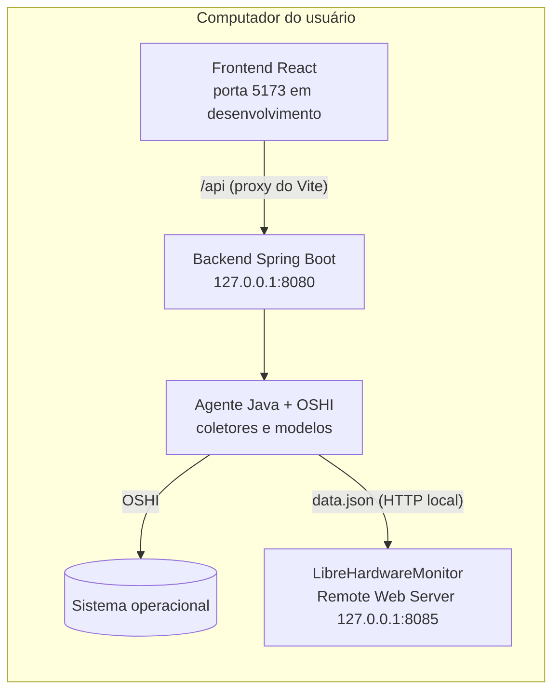
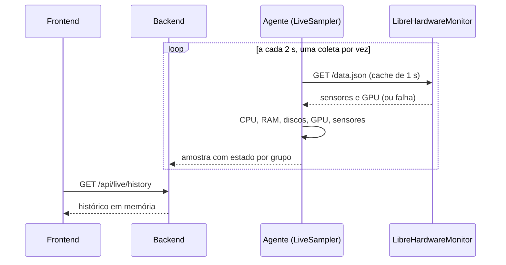
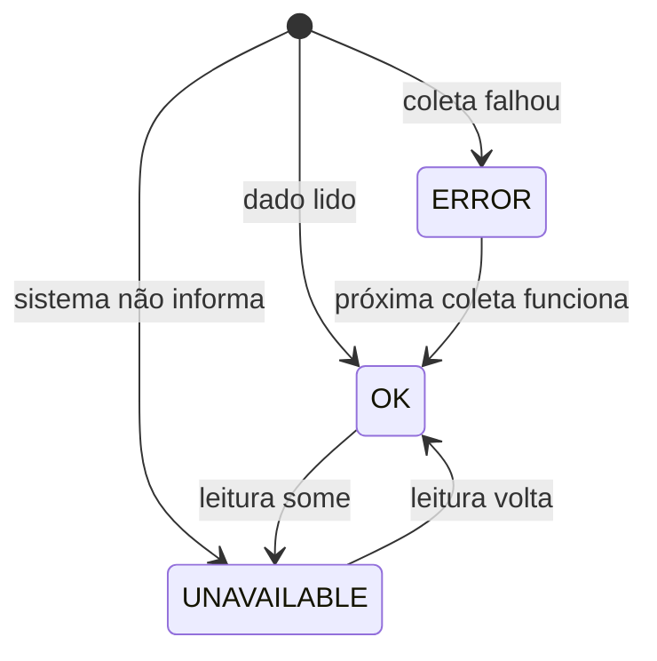

# Diagramas — PCCheck

Os diagramas usam Mermaid, renderizado pelo GitHub. Cada diagrama tem descrição em texto para leitores que não podem
vê-lo.

## Visão geral dos componentes

**Descrição em texto:** o frontend envia requisições `/api` para o backend. O backend usa o agente, que lê o sistema
operacional pela biblioteca OSHI e, para GPU e sensores, consulta o LibreHardwareMonitor em `127.0.0.1:8085`. Tudo
acontece no mesmo computador.

## Fluxo do Live Monitor

**Descrição em texto:** o agendador do backend executa uma coleta por vez. Em cada coleta, o agente consulta o
LibreHardwareMonitor (com cache de 1 segundo), monta CPU, RAM, GPU, discos e sensores, e guarda a amostra na memória.
O frontend lê o histórico pela API. Se o LibreHardwareMonitor não responder, só GPU e sensores ficam "Sem leitura"; os
demais grupos seguem normalmente.

## Estados de um grupo de métricas

**Descrição em texto:** cada grupo (CPU, RAM, GPU, discos, sensores) pode estar em OK, UNAVAILABLE ou ERROR. Os
estados mudam a cada coleta. Nenhum deles estima valores.
